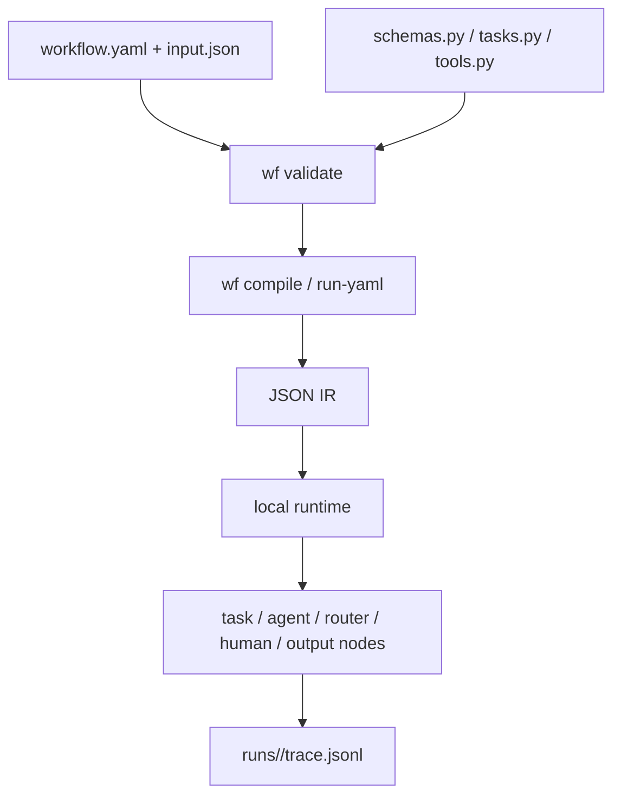

# Workflow as Code

Define workflows in YAML, wire Python task/tool/schema registries, compile to JSON IR, run locally, and inspect traces.

## Table of contents

- [Quick start](#quick-start)
- [Create a workflow](#create-a-workflow)
- [Architecture](#architecture)
- [Commands](#commands)
- [Workflow structure](#workflow-structure)
- [Providers](#providers)
- [Examples](#examples)
- [IR and traces](#ir-and-traces)
- [Limitations](#limitations)

## Quick start

```bash
python -m venv .venv
source .venv/bin/activate
python -m pip install -e .

wf validate examples/restaurant_takeout/workflow.yaml
wf run-yaml examples/restaurant_takeout/workflow.yaml \
  --input examples/restaurant_takeout/input.json
```

Sample input in `examples/restaurant_takeout/input.json`:

```json
{
  "customer_name": "Nova",
  "items": ["burger", "fries", "soda"]
}
```

Nova is ordering burger, fries, and soda. Prices are defined in `examples/restaurant_takeout/tasks.py` in the `_MENU` dictionary.

Expected stdout:

```json
{
  "message": "Order accepted for Nova",
  "status": "accepted",
  "total": 21.77
}
```

The run also prints a run id and trace path on stderr:

```text
run_id: <run_id>
trace: runs/<run_id>/trace.jsonl
```

Inspect the latest trace and run tests:

```bash
wf trace --latest
python -m unittest discover -s tests
```

## Create a workflow

Scaffold a valid workflow:

```bash
wf init my_workflow
wf validate examples/my_workflow/workflow.yaml
wf run-yaml examples/my_workflow/workflow.yaml --input examples/my_workflow/input.json
```

Default output from the `basic` template:

```json
{
  "message": "Welcome aboard, Nova — your workflow is running!"
}
```

Generated files:

```text
examples/my_workflow/
  __init__.py
  workflow.yaml
  input.json
  schemas.py
  tasks.py
  tools.py
```

Templates and useful flags:

| Command | Purpose |
|---|---|
| `wf init name --template basic` | task → output |
| `wf init name --template router` | task → router → two outputs |
| `wf init name --template agent` | task → agent → output |
| `wf init name --template human` | task → human approval → output |
| `wf init name --dir workflows` | create outside `examples/` |
| `wf init name --with-test` | generate `tests/test_<name>.py` |
| `wf init name --force` | replace an existing workflow folder |

After editing generated files, rerun `wf validate`.

## Architecture



Supported node kinds:

| Kind | Purpose |
|---|---|
| `task` | deterministic Python function |
| `agent` | provider-backed LLM step |
| `router` | branch based on prior output |
| `human` | approval gate; use `--auto-approve` for local smoke runs |
| `output` | final workflow result |

## Commands

| Command | Purpose |
|---|---|
| `wf init <name>` | scaffold a workflow |
| `wf validate <workflow.yaml>` | validate workflow YAML |
| `wf compile <workflow.yaml> --out <file.ir.json>` | compile YAML to JSON IR |
| `wf run <file.ir.json> --input <input.json>` | run compiled IR |
| `wf run-yaml <workflow.yaml> --input <input.json>` | validate, compile in memory, and run |
| `wf trace --latest` | print latest trace |
| `wf trace runs/<run_id>/trace.jsonl` | print a specific trace |

## Workflow structure

One folder contains one workflow:

```text
examples/<workflow_name>/
  __init__.py
  workflow.yaml
  input.json
  schemas.py
  tasks.py
  tools.py
```

| File | Purpose |
|---|---|
| `workflow.yaml` | graph, routing, registries, input/output schemas |
| `input.json` | sample runtime input |
| `schemas.py` | dataclass contracts |
| `tasks.py` | deterministic functions referenced by `uses:` |
| `tools.py` | agent tools, or a placeholder if unused |
| `__init__.py` | makes the folder importable |

## Providers

Agent nodes use `--provider`.

| Provider | Use |
|---|---|
| `fake` | default deterministic provider for tests/demos |
| `anthropic` | Anthropic Messages API |
| `fuelix` | Fuel iX Anthropic-compatible API |

Examples:

```bash
wf run-yaml examples/support/workflow.yaml \
  --input examples/support/input.json \
  --provider fake \
  --auto-approve

ANTHROPIC_API_KEY=... wf run-yaml examples/support/workflow.yaml \
  --input examples/support/input.json \
  --provider anthropic \
  --model claude-3-5-sonnet-20241022 \
  --auto-approve

FUELIX_API_KEY=... wf run-yaml examples/support/workflow.yaml \
  --input examples/support/input.json \
  --provider fuelix \
  --model claude-haiku-5-5 \
  --auto-approve
```

Fuel iX also accepts Claude Code-style environment variables:

```bash
ANTHROPIC_BASE_URL=https://api.fuelix.ai
ANTHROPIC_AUTH_TOKEN=...
```

Provider rules: default is `fake`; allowed values are `fake`, `anthropic`, `fuelix`; agent output must be valid JSON matching the node `output_schema`; agents may call only tools listed on the node.

## Examples

| Folder | Workflow | Purpose |
|---|---|---|
| `examples/restaurant_takeout/` | `restaurant_takeout` | validates takeout items and calculates total |
| `examples/exchange/` | `exchange` | converts money using deterministic exchange-rate tasks |
| `examples/test_workflow/` | `test_triage` | routes refund through exchange steps |
| `examples/support/` | `support_triage` | support triage with agent and human approval nodes |

## IR and traces

IR means **Intermediate Representation**: the compiled JSON workflow graph used by the runtime.

```text
workflow.yaml -> build/*.ir.json -> runtime execution
```

Every run writes JSONL trace events under:

```text
runs/<run_id>/trace.jsonl
```

Human-readable trace example:

```text
create_order             task     succeeded
check_menu_items         task     succeeded
route_order_status       router   succeeded  selected=valid target=calculate_total
calculate_total          task     succeeded
finish_accepted          output   succeeded
```

## Limitations

- No hosted service or visual builder.
- Anthropic/Fuel iX providers are local, non-streaming adapters.
- No durable multi-day execution.
- No parallel branches or sub-workflows.
- YAML loader supports only the subset needed by this MVP.
- Example money calculations use floats; production money logic should use `Decimal`.
