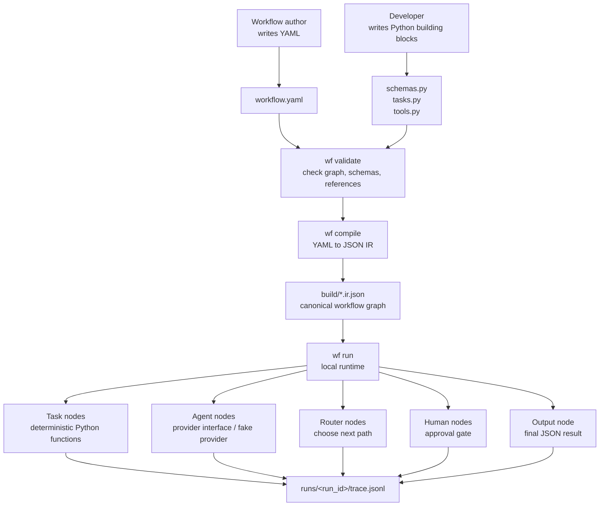

# Workflow as Code

A local workflow-as-code MVP. Define workflows in YAML, compile them into a JSON intermediate representation, and run them with a Python runtime.

## What this project does

The MVP proves this flow:

```text
workflow.yaml -> compile -> build/*.ir.json -> run -> trace.jsonl
```

## Architecture



Human view:

| Layer | What the user sees | What the engine uses |
|---|---|---|
| Authoring | `workflow.yaml`, `input.json` | YAML workflow definition |
| Building blocks | `schemas.py`, `tasks.py`, `tools.py` | Importable Python registries |
| Compile step | `wf compile ... --out build/name.ir.json` | JSON IR graph |
| Runtime | `wf run build/name.ir.json --input input.json` | Nodes, edges, state, providers |
| Debugging | `runs/<run_id>/trace.jsonl` | Per-node execution events |

Supported node kinds:

| Kind | Purpose |
|---|---|
| `task` | Run a deterministic Python function from a task registry |
| `agent` | Run an LLM-style node through the provider interface; currently backed by a deterministic fake provider |
| `router` | Route to another node based on prior output |
| `human` | Pause for approval; local smoke runs can use `--auto-approve` |
| `output` | Produce final workflow output |

## Requirements

- Python 3.10+
- No required third-party Python packages for the current MVP

Commands below assume you are at the repository root.

## Quick start

Create a virtual environment and install the local CLI:

```bash
python -m venv .venv
source .venv/bin/activate
python -m pip install -e .
```

Validate the restaurant workflow:

```bash
wf validate examples/restaurant_takeout/workflow.yaml
```

Run the YAML workflow directly:

```bash
wf run-yaml examples/restaurant_takeout/workflow.yaml \
  --input examples/restaurant_takeout/input.json
```

Expected stdout with the current sample input:

```json
{
  "message": "Order accepted for Michael",
  "status": "accepted",
  "total": 21.77
}
```

Expected stderr includes the run id and trace path:

```text
run_id: <run_id>
trace: runs/<run_id>/trace.jsonl
```

Inspect the latest trace:

```bash
wf trace --latest
```

Run all tests:

```bash
python -m unittest discover -s tests
```

## Compile/run separately

`wf run-yaml` is the easiest command for local usage. The lower-level commands remain available when you want to inspect or reuse compiled IR:

```bash
wf compile examples/restaurant_takeout/workflow.yaml --out build/restaurant_takeout.ir.json
wf run build/restaurant_takeout.ir.json --input examples/restaurant_takeout/input.json
```

## Workflow folder structure

Each workflow example uses this shape:

```text
examples/<workflow_name>/
  __init__.py
  workflow.yaml
  input.json
  schemas.py
  tasks.py
  tools.py
```

Meaning:

| File | Purpose |
|---|---|
| `workflow.yaml` | Workflow graph: nodes, routing, registries, input/output schemas |
| `input.json` | Sample runtime input |
| `schemas.py` | Dataclass contracts used by validation/runtime |
| `tasks.py` | Deterministic task functions referenced by `uses:` |
| `tools.py` | Agent tool registry, or placeholder when unused |
| `__init__.py` | Makes the folder importable |

## Example workflows

| Folder | Workflow name | Purpose |
|---|---|---|
| `examples/restaurant_takeout/` | `restaurant_takeout` | Validates takeout items and calculates total |
| `examples/exchange/` | `exchange` | Converts money using deterministic exchange-rate tasks |
| `examples/test_workflow/` | `test_triage` | Classifies a test message and routes refund through exchange steps |
| `examples/support/` | `support_triage` | Support-ticket triage with agent and human approval nodes |

## Providers

Agent nodes use a provider selected at runtime.

| Provider | Purpose |
|---|---|
| `fake` | Default deterministic provider for tests and local demos |
| `anthropic` | Real Anthropic Messages API adapter |

Use the fake provider explicitly:

```bash
wf run-yaml examples/support/workflow.yaml \
  --input examples/support/input.json \
  --provider fake \
  --auto-approve
```

Use Anthropic when credentials are available:

```bash
ANTHROPIC_API_KEY=... wf run-yaml examples/support/workflow.yaml \
  --input examples/support/input.json \
  --provider anthropic \
  --model claude-3-5-sonnet-20241022 \
  --auto-approve
```

Provider rules:

- default provider: `fake`
- allowed providers: `fake`, `anthropic`
- Anthropic is non-streaming in this phase
- Anthropic requires `ANTHROPIC_API_KEY`
- Anthropic model can be set with `--model` or `ANTHROPIC_MODEL`
- agent output must be valid JSON matching the node `output_schema`
- agents may call only tools listed on the node

## Build a new workflow

1. Create a folder:

```bash
mkdir -p examples/my_workflow
touch examples/my_workflow/__init__.py
```

2. Add data contracts in `schemas.py`.
3. Add deterministic functions in `tasks.py`.
4. Add tools in `tools.py`, or a placeholder docstring if unused.
5. Add sample input in `input.json`.
6. Add graph wiring in `workflow.yaml`.
7. Validate, compile, run.
8. Add a test in `tests/test_mvp.py`.

## IR

IR means **Intermediate Representation**. In this project, it is the compiled JSON workflow graph used by the runtime.

Example:

```text
examples/restaurant_takeout/workflow.yaml
  -> build/restaurant_takeout.ir.json
  -> runtime execution
```

The concept is standard in compilers and systems. The JSON schema here is project-specific.

## Traces

Every run writes a trace file and prints its path on stderr:

```text
run_id: <run_id>
trace: runs/<run_id>/trace.jsonl
```

Inspect the latest trace with:

```bash
wf trace --latest
```

Or inspect a specific trace:

```bash
wf trace runs/<run_id>/trace.jsonl
```

Example output:

```text
create_order             task     succeeded
check_menu_items         task     succeeded
route_order_status       router   succeeded  selected=valid target=calculate_total
calculate_total          task     succeeded
finish_accepted          output   succeeded
```

Raw traces are JSONL files. Each line records one executed node, including node id, kind, status, output summary, and routing choices.

## Current limitations

- No hosted service.
- No visual builder.
- Anthropic provider support is local/experimental and non-streaming.
- No durable multi-day execution.
- No parallel branches or sub-workflows.
- The YAML loader supports only the subset needed by this MVP.
- Money calculations in examples use floats; production money logic should use `Decimal`.
