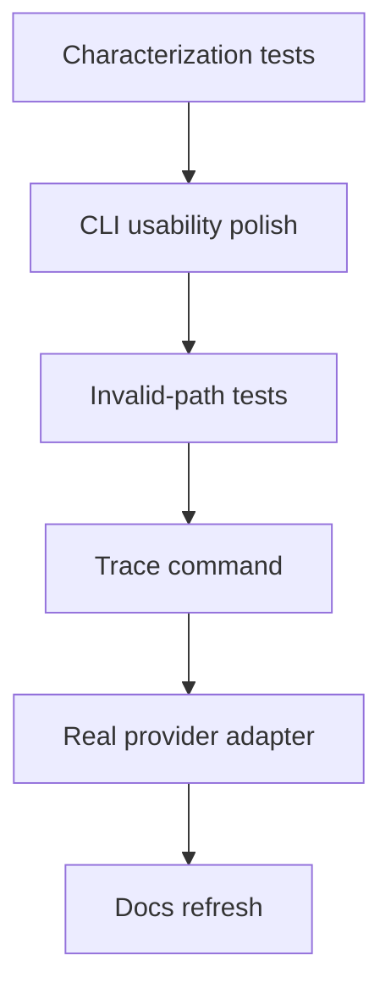

# Phase 2 Plan: Real Provider + Better Developer UX

## Goal

Turn the MVP from a local demo engine into a usable workflow authoring/runtime tool.

The current system proves YAML → IR → runtime, but agent nodes use a fake provider, workflow errors are basic, traces are raw JSONL, and users still need `PYTHONPATH` or editable install knowledge.

Phase 2 should improve usability and debugging before expanding into hosted infrastructure.

## Decision

Prioritize the smallest changes that make the platform feel real without expanding scope into hosted UI or distributed execution.

Recommended focus:

1. Characterization tests for current success and failure behavior.
2. CLI usability polish.
3. Invalid-path test coverage with exact contracts.
4. Better trace inspection and trace discovery.
5. Real LLM provider adapter with tightly bounded behavior.
6. Documentation refresh.

## 0. Characterization tests

### Goal

Protect existing behavior before changing CLI and runtime surfaces.

### Deliverables

- Keep current successful workflow tests passing.
- Add or confirm tests for:
  - restaurant valid-order success path
  - support refund path
  - support bug path
  - exchange workflow
  - test workflow refund route

### Acceptance

```bash
PYTHONPATH=src:. python -m unittest discover -s tests
```

passes before Phase 2 refactors begin.

## 1. CLI usability polish

### Goal

Make normal commands simple and reduce the need for `PYTHONPATH` in day-to-day use.

### Deliverables

- Ensure editable install works cleanly inside a virtual environment:

```bash
python -m venv .venv
source .venv/bin/activate
python -m pip install -e .
```

- Keep existing commands:

```bash
wf validate <workflow.yaml>
wf compile <workflow.yaml> --out <workflow.ir.json>
wf run <workflow.ir.json> --input <input.json>
```

- Add combined YAML run command:

```bash
wf run-yaml examples/restaurant_takeout/workflow.yaml --input examples/restaurant_takeout/input.json
```

- `wf run` and `wf run-yaml` must print these on success:
  - final output JSON on stdout
  - run id on stderr
  - trace path on stderr

Example stderr:

```text
run_id: 20261015190315-38f3cd49
trace: runs/20261015190315-38f3cd49/trace.jsonl
```

- Improve command help text for all commands.
- Improve named error messages for the failure contracts in section 2.

### Provider CLI contract

Provider selection is part of CLI polish because both `wf run` and `wf run-yaml` need the same behavior.

| Setting | Contract |
|---|---|
| Default provider | `fake` |
| Allowed providers | `fake`, `anthropic`, `fuelix` |
| Unknown provider | nonzero exit; message includes provider name and allowed values |
| Anthropic model default | documented default in README and provider module |
| Anthropic/Fuel iX model override | `--model <model>` or documented environment variable |

### Acceptance

```bash
python -m venv .venv
source .venv/bin/activate
python -m pip install -e .
wf validate examples/restaurant_takeout/workflow.yaml
wf run-yaml examples/restaurant_takeout/workflow.yaml --input examples/restaurant_takeout/input.json
```

works without setting `PYTHONPATH`, and the run output includes a usable trace path.

## 2. Invalid-path test coverage

### Goal

Prove expected failures and non-happy paths, not only successful workflow runs.

### Deliverables

- Add invalid restaurant input:

```text
examples/restaurant_takeout/input_invalid.json
```

- Add test showing invalid menu item routes to `finish_rejected`.
- Add validation/runtime failure tests with exact expected diagnostics.

### Failure contracts

| Case | Stage | Command/API under test | Expected result | Required diagnostic content | Artifact rule |
|---|---|---|---|---|---|
| unknown task | validate/compile | `wf validate bad_workflow.yaml` or `compile_file` | nonzero CLI exit or `WorkflowValidationError` | node id, missing task name | no run trace |
| missing schema | validate/compile | `wf validate bad_workflow.yaml` or `compile_file` | nonzero CLI exit or `WorkflowValidationError` | schema name, registry module | no run trace |
| unreachable node | validate/compile | `wf validate bad_workflow.yaml` or `compile_file` | nonzero CLI exit or `WorkflowValidationError` | unreachable node id | no run trace |
| bad input type | runtime | `wf run ... --input bad_input.json` or `WorkflowRuntime.run` | nonzero CLI exit or `ValidationError` | field path, expected type, actual type | failed trace may exist if run started |
| missing task input | runtime | `wf run ...` or `WorkflowRuntime.run` | nonzero CLI exit or `ValidationError` | node id, missing input name | failed trace may exist if run started |
| invalid provider name | CLI parse/runtime setup | `wf run-yaml ... --provider bogus` | nonzero CLI exit | invalid provider name, allowed providers | no run trace |

### Acceptance

```bash
python -m unittest discover -s tests
```

covers successful workflows, invalid routing, and the failure contracts above.

## 3. Better trace inspection

### Goal

Make traces useful without manually reading raw JSONL.

### Deliverables

- Add command:

```bash
wf trace runs/<run_id>/trace.jsonl
```

- Add latest trace convenience:

```bash
wf trace --latest
```

`--latest` means the newest `runs/*/trace.jsonl` by directory modification time.

- `wf run` and `wf run-yaml` must print the trace path, so users can run `wf trace <printed-path>` without guessing.

Expected human-readable output shape:

```text
create_order          task      succeeded
check_menu_items      task      succeeded
route_order_status    router    succeeded  selected=valid target=calculate_total
calculate_total       task      succeeded
finish_accepted       output    succeeded
```

### Trace command contracts

| Input | Expected behavior |
|---|---|
| normal trace | prints events in file order |
| router event | includes `selected=<value>` and `target=<node>` when present |
| failed event | includes `failed` and the error text |
| malformed JSONL | nonzero exit; message includes file path and line number |
| missing file | nonzero exit; message includes file path |
| `--latest` with no runs | nonzero exit; message says no traces found |

### Acceptance

```bash
wf run-yaml examples/restaurant_takeout/workflow.yaml --input examples/restaurant_takeout/input.json
wf trace runs/<printed-run-id>/trace.jsonl
wf trace --latest
```

prints node-by-node execution with router choices and failures when present.

## 4. Real LLM provider adapter

### Goal

Make `agent` nodes call a real model while keeping deterministic fake provider tests.

### Minimal adapter contract

| Area | Phase 2 contract |
|---|---|
| Provider names | `fake`, `anthropic`, `fuelix` |
| Default provider | `fake` |
| Request mode | non-streaming only |
| Model | one documented default model; override via `--model` or documented environment variable |
| Structured output | final model response parsed once as JSON and validated against `output_schema` |
| Tool use | declared tools only; bounded tool/model turns |
| Turn limit | use node `policy.max_steps` when present; otherwise documented default |
| Retries | none in Phase 2 unless already provided by existing runtime behavior |
| Tests | fake provider remains default; Anthropic-compatible adapters get credential-free contract tests with stubbed transport |

### Deliverables

- Add provider selection:

```bash
wf run build/support_triage.ir.json --input examples/support/input.json --provider fake
wf run build/support_triage.ir.json --input examples/support/input.json --provider anthropic
wf run build/support_triage.ir.json --input examples/support/input.json --provider fuelix
```

- Add `ANTHROPIC_API_KEY` support for Anthropic and `FUELIX_API_KEY` / `ANTHROPIC_AUTH_TOKEN` support for Fuel iX.
- Add `--model <model>` or a documented model environment variable.
- Implement structured output parsing.
- Keep `FakeAgentProvider` as the test default.
- Add a stubbed Anthropic transport test that verifies:
  - request construction includes instructions and node inputs
  - only declared tools are exposed
  - valid JSON output becomes a schema-valid dataclass/dict
  - invalid JSON fails clearly
  - schema-invalid JSON fails clearly
- Fail clearly if:
  - API key is missing
  - model output is invalid JSON
  - output does not match schema
  - agent tries an undeclared tool
  - provider name is unknown

### Acceptance

Credential-free automated acceptance:

```bash
python -m unittest discover -s tests
```

includes stubbed Anthropic/Fuel iX adapter tests and fake-provider workflow tests.

Live-provider acceptance when credentials are available:

```bash
ANTHROPIC_API_KEY=... wf run-yaml examples/support/workflow.yaml --input examples/support/input.json --provider anthropic --auto-approve
FUELIX_API_KEY=... wf run-yaml examples/support/workflow.yaml --input examples/support/input.json --provider fuelix --auto-approve
```

runs an actual agent node and returns schema-valid output. If credentials are unavailable, the live smoke is skipped but the stubbed adapter tests remain required.

### Risk

Provider APIs and tool-use formats are more complex than the fake provider. Keep the adapter small and isolated behind the existing provider interface.

## 5. Documentation refresh

### Goal

Update docs so a new user can clone, install, run, inspect traces, and understand provider configuration.

### Deliverables

- README quickstart updated to use installed `wf` command.
- Provider documentation:
  - fake provider
  - Anthropic provider
  - environment variables
  - default model and model override
- Troubleshooting section:
  - import errors
  - validation errors
  - recompile reminder
  - missing trace path
  - invalid provider output

### Acceptance

The README contains a clean-environment walkthrough from clone:

```bash
git clone <repo-url>
cd workflow-as-code
python -m venv .venv
source .venv/bin/activate
python -m pip install -e .
wf run-yaml examples/restaurant_takeout/workflow.yaml --input examples/restaurant_takeout/input.json
wf trace --latest
python -m unittest discover -s tests
```

The walkthrough lists prerequisites, expected output, expected artifacts, and the trace-discovery step.

## Recommended execution order



Reasoning:

1. Characterization tests protect the first refactor.
2. CLI polish helps every later step.
3. Invalid-path tests make diagnostics explicit before provider work.
4. Trace command improves debugging real provider behavior.
5. Real provider comes after better diagnostics.
6. Docs last so they match final behavior.

## Out of scope for Phase 2

Do not build in this phase:

- web UI
- visual builder
- hosted service
- Temporal backend
- distributed workers
- persistent approval/resume
- full LangGraph adapter
- multi-tenant auth
- secrets manager
- complex expression language
- parallel branches
- streaming provider responses
- provider retry policy
- multiple provider routing
- advanced tool schemas beyond the current registry functions

Generated artifacts remain ignored and uncommitted:

- `build/`
- `runs/`
- `__pycache__/`

## Phase 2 acceptance criteria

Phase 2 is done when these work locally from a clean clone after editable install:

```bash
python -m venv .venv
source .venv/bin/activate
python -m pip install -e .
wf run-yaml examples/restaurant_takeout/workflow.yaml --input examples/restaurant_takeout/input.json
wf trace --latest
wf run-yaml examples/support/workflow.yaml --input examples/support/input.json --provider fake --auto-approve
python -m unittest discover -s tests
```

The test suite must include credential-free Anthropic and Fuel iX adapter contract tests.

When `ANTHROPIC_API_KEY` or `FUELIX_API_KEY` is available, this live smoke must also pass or produce a documented provider/API failure:

```bash
ANTHROPIC_API_KEY=... wf run-yaml examples/support/workflow.yaml --input examples/support/input.json --provider anthropic --auto-approve
FUELIX_API_KEY=... wf run-yaml examples/support/workflow.yaml --input examples/support/input.json --provider fuelix --auto-approve
```

## Recommendation

Start with characterization tests and CLI usability polish. Then lock failure contracts before implementing trace tooling and the real provider adapter. This gives immediate product improvement with low risk and makes real provider integration much easier to debug.
