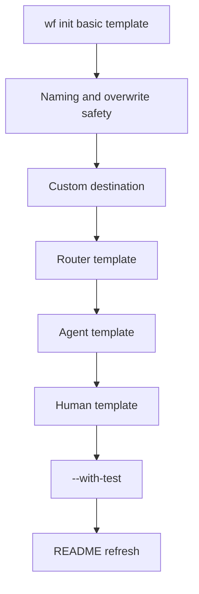

# Phase 3 Plan: Workflow Creation UX

## Goal

Make workflow creation simpler.

Phase 2 made running workflows easier with `wf run-yaml`, provider selection, and trace inspection. Phase 3 should reduce the manual work required to create a new workflow. Users should not need to remember the six-file folder structure or copy an existing example by hand.

## Decision

Add workflow scaffolding to the CLI.

Primary command:

```bash
wf init <name>
```

Default behavior creates a valid workflow folder under `examples/`.

## Problem

Creating a workflow currently requires users to manually create:

```text
examples/<workflow_name>/
  __init__.py
  workflow.yaml
  input.json
  schemas.py
  tasks.py
  tools.py
```

Then they must ensure:

- YAML registry paths match the folder name.
- schema class names match YAML `input_schema` / `output_schema`.
- task function names match YAML `uses:`.
- sample input matches the input schema.
- generated workflow validates and runs.

This is too much ceremony for a first workflow.

## Phase 3 deliverables

## 1. `wf init <name>`

### Goal

Create a new workflow skeleton from a template.

### Command

```bash
wf init pizza_order
```

### Output

```text
examples/pizza_order/
  __init__.py
  workflow.yaml
  input.json
  schemas.py
  tasks.py
  tools.py
```

The generated workflow must be valid immediately.

### Acceptance

```bash
wf init pizza_order
wf validate examples/pizza_order/workflow.yaml
wf run-yaml examples/pizza_order/workflow.yaml --input examples/pizza_order/input.json
```

works without hand-editing generated files.

## 2. Template options

### Goal

Let users start from common workflow shapes.

### Command examples

```bash
wf init demo_basic --template basic
wf init demo_router --template router
wf init demo_agent --template agent
wf init demo_human --template human
```

### Templates

| Template | Purpose |
|---|---|
| `basic` | deterministic task → output |
| `router` | task → router → two outputs |
| `agent` | task → agent → output |
| `human` | task → human approval → output |

Default:

```bash
--template basic
```

### Acceptance

These commands create workflows that validate:

```bash
wf init demo_basic --template basic
wf init demo_router --template router
wf init demo_agent --template agent
wf init demo_human --template human
wf validate examples/demo_basic/workflow.yaml
wf validate examples/demo_router/workflow.yaml
wf validate examples/demo_agent/workflow.yaml
wf validate examples/demo_human/workflow.yaml
```

The `basic`, `router`, and `human` templates should run locally without real provider credentials. The `agent` template should run with `--provider fake`.

## 3. Safer naming

### Goal

Prevent unsafe paths and confusing workflow names.

### Rules

Input name:

```bash
wf init "Pizza Order"
```

Creates:

```text
examples/pizza_order/
```

YAML contains:

```yaml
name: pizza_order
```

Normalization rules:

- lowercase
- trim leading/trailing whitespace
- spaces and dashes become underscores
- collapse repeated underscores
- allow only letters, numbers, and underscores
- reject names that are empty after normalization
- reject path traversal or path separators such as `../bad` or `foo/bar`
- refuse to overwrite an existing folder unless `--force` is passed

### Acceptance

```bash
wf init "Pizza Order"
wf init ../bad
wf init pizza_order
wf init pizza_order --force
```

Expected behavior:

- `"Pizza Order"` succeeds and creates `examples/pizza_order/`.
- `../bad` fails with a clear unsafe-name error.
- `pizza_order` fails if the folder already exists.
- `pizza_order --force` replaces/regenerates the workflow folder.

## 4. Optional destination

### Goal

Allow users to scaffold outside `examples/`.

### Command

```bash
wf init pizza_order --dir workflows
```

Creates:

```text
workflows/pizza_order/
```

Default destination:

```text
examples/
```

### Registry path rule

When `--dir examples` is used, generated registry paths should be importable as:

```yaml
registries:
  tasks: examples.pizza_order.tasks
  tools: examples.pizza_order.tools
  schemas: examples.pizza_order.schemas
```

When a custom `--dir` is used, the directory must be importable from the repository root. If needed, generate `__init__.py` in the destination root.

Example for `--dir workflows`:

```yaml
registries:
  tasks: workflows.pizza_order.tasks
  tools: workflows.pizza_order.tools
  schemas: workflows.pizza_order.schemas
```

### Acceptance

```bash
wf init pizza_order --dir workflows
wf validate workflows/pizza_order/workflow.yaml
wf run-yaml workflows/pizza_order/workflow.yaml --input workflows/pizza_order/input.json
```

works from the repository root.

## 5. Optional generated test

### Goal

Make it easy to add workflow regression coverage.

### Command

```bash
wf init pizza_order --with-test
```

Creates:

```text
tests/test_pizza_order.py
```

Recommendation: create a separate test file instead of appending to `tests/test_mvp.py`.

### Acceptance

```bash
wf init pizza_order --with-test
python -m unittest discover -s tests
```

passes.

## 6. Documentation refresh

### Goal

Teach users how to create their first workflow.

### README additions

Add a “Create your first workflow” section:

```bash
wf init my_workflow
wf validate examples/my_workflow/workflow.yaml
wf run-yaml examples/my_workflow/workflow.yaml --input examples/my_workflow/input.json
```

Explain:

- what files were generated
- how `workflow.yaml` references `tasks.py` and `schemas.py`
- when to use templates
- how to rerun validation
- how to add a generated test with `--with-test`

## Recommended first template: `basic`

Generated `schemas.py`:

```python
from __future__ import annotations

from dataclasses import dataclass


@dataclass(frozen=True)
class BasicInput:
    name: str


@dataclass(frozen=True)
class Greeting:
    message: str


@dataclass(frozen=True)
class BasicResult:
    message: str
```

Generated `tasks.py`:

```python
from __future__ import annotations

from examples.my_workflow.schemas import Greeting


def create_greeting(name: str) -> Greeting:
    return Greeting(message=f"Welcome aboard, {name} — your workflow is running!")
```

Generated `tools.py`:

```python
"""No agent tools are needed for this workflow."""
```

Generated `workflow.yaml`:

```yaml
name: my_workflow
version: 0.1.0

input_schema: BasicInput
output_schema: BasicResult

registries:
  tasks: examples.my_workflow.tasks
  tools: examples.my_workflow.tools
  schemas: examples.my_workflow.schemas

nodes:
  - id: create_greeting
    kind: task
    uses: create_greeting
    input:
      name: "${input.name}"

  - id: finish
    kind: output
    value:
      message: "${nodes.create_greeting.output.message}"
```

Generated `input.json`:

```json
{
  "name": "Nova"
}
```

Expected run result:

```json
{
  "message": "Welcome aboard, Nova — your workflow is running!"
}
```

## Phase 3 acceptance criteria

Phase 3 is done when these work:

```bash
wf init hello_world
wf validate examples/hello_world/workflow.yaml
wf run-yaml examples/hello_world/workflow.yaml --input examples/hello_world/input.json
```

Expected output:

```json
{
  "message": "Welcome aboard, Nova — your workflow is running!"
}
```

And these pass:

```bash
wf init route_demo --template router
wf init agent_demo --template agent
wf init human_demo --template human --with-test
python -m unittest discover -s tests
```

## Out of scope for Phase 3

Do not build in this phase:

- visual builder
- interactive wizard
- schema inference from natural language
- web UI
- package publishing
- remote template registry
- full cookiecutter-style engine
- multiple workflows per folder
- editing existing workflows interactively

## Recommended execution order



## Recommendation

Start with:

```bash
wf init <name> --template basic
```

Then add safer naming, custom destinations, additional templates, and `--with-test`.

This improves user experience immediately without changing the runtime model.
