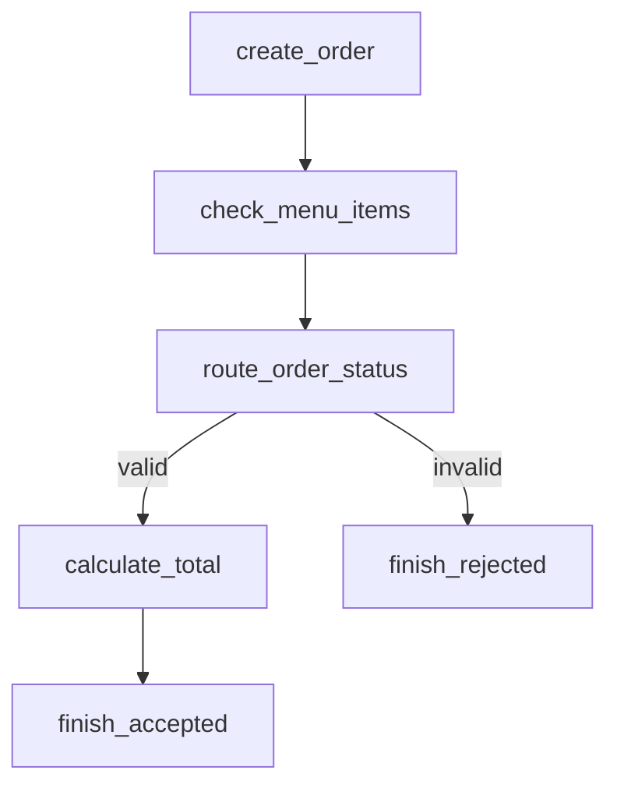
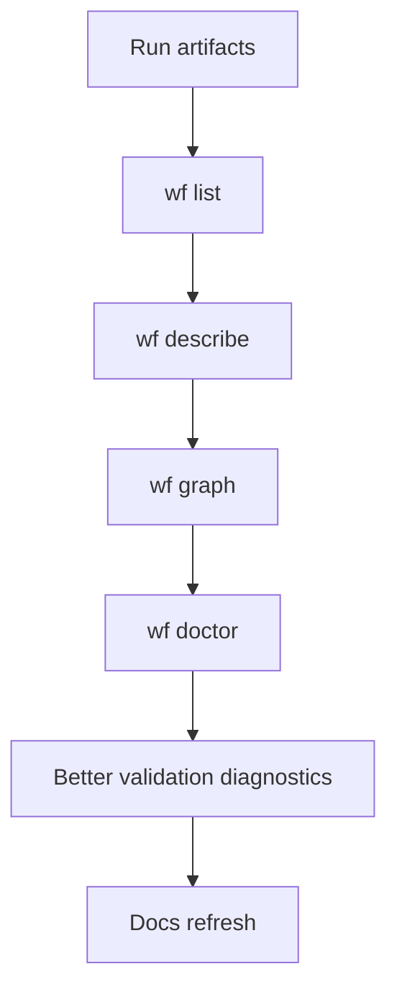

# Phase 4 Plan: Workflow Authoring Assistant

## Goal

Make users productive after `wf init`.

Phase 3 made workflow creation easier. The next bottleneck is editing, validating, and debugging real workflows as they grow. Users can scaffold workflows now, but they still need help understanding YAML, references, schemas, traces, and failures.

Phase 4 should help users answer:

- What workflows exist?
- Is this workflow valid?
- What does this workflow graph look like?
- Why did this workflow fail?
- What input/output schemas does this workflow expect?
- How do I add or inspect nodes safely?

## Decision

Focus on workflow authoring quality-of-life and debugging. Do not build a web UI yet.

## 1. `wf list`

### Goal

List discovered workflows.

### Command

```bash
wf list
```

Expected output:

```text
examples/restaurant_takeout/workflow.yaml    restaurant_takeout    6 nodes
examples/support/workflow.yaml               support_triage        11 nodes
examples/exchange/workflow.yaml              exchange              3 nodes
```

### Flags

```bash
wf list --dir examples
wf list --json
```

### Acceptance

- Finds `workflow.yaml` files recursively.
- Shows path, workflow name, and node count.
- Invalid workflows show `invalid` and a concise error.
- `--json` returns machine-readable output.

## 2. `wf describe <workflow.yaml>`

### Goal

Summarize a workflow.

### Command

```bash
wf describe examples/restaurant_takeout/workflow.yaml
```

Expected output:

```text
Workflow: restaurant_takeout
Input:    TakeoutInput
Output:   TakeoutResult
Nodes:    6

Start:
  create_order

Nodes:
  create_order         task      uses=create_order
  check_menu_items     task      uses=check_menu_items
  route_order_status   router    switch=${nodes.check_menu_items.output.status}
  calculate_total      task      uses=calculate_total
  finish_accepted      output
  finish_rejected      output

Routes:
  route_order_status.valid    -> calculate_total
  route_order_status.invalid  -> finish_rejected
```

### Flags

```bash
wf describe <workflow.yaml> --json
wf describe <workflow.ir.json> --ir
```

### Acceptance

- Works for workflow YAML.
- Works for compiled IR when `--ir` is passed.
- Shows input/output schemas.
- Shows node kinds.
- Shows task `uses`, router cases, human reviewers, and agent model/tools.
- Emits JSON when requested.

## 3. `wf graph <workflow.yaml>`

### Goal

Generate a visual graph representation.

### Command

```bash
wf graph examples/restaurant_takeout/workflow.yaml
```

Default output: Mermaid.



### Flags

```bash
wf graph examples/restaurant_takeout/workflow.yaml --format mermaid
wf graph examples/restaurant_takeout/workflow.yaml --format dot
wf graph examples/restaurant_takeout/workflow.yaml --out graph.mmd
```

### Acceptance

- Uses compiled IR edges.
- Includes router edge labels.
- Output is deterministic.
- `--out` writes to a file.

## 4. Better validation diagnostics

### Goal

Make validation failures easier to understand as workflows grow.

Current validation errors are usable but not friendly enough for larger workflows.

### Improved error format

Example:

```text
workflow validation failed: examples/pizza_store/workflow.yaml

node route_availability:
  case "available" targets missing node "calculate_total"

Suggested fix:
  - Add a node with id "calculate_total"
  - Or change cases.available to an existing node id
```

### Improvements

Validation errors should include:

- workflow path
- node id
- field path
- bad reference
- suggested fix when obvious

### Acceptance

- Unknown task names include nearest available task name if close.
- Missing node references list existing node ids.
- Bad expressions show allowed forms:
  - `${input.field}`
  - `${nodes.node_id.output.field}`

## 5. `wf doctor <workflow.yaml>`

### Goal

Provide one command for debugging workflow setup.

### Commands

```bash
wf doctor examples/restaurant_takeout/workflow.yaml
wf doctor examples/restaurant_takeout/workflow.yaml --input examples/restaurant_takeout/input.json
wf doctor examples/support/workflow.yaml --provider fake --auto-approve
```

### Checks

- validation
- registry importability
- input file exists when provided
- compile to IR
- optional actual run when `--input` is provided

### Acceptance

- Prints pass/fail checklist.
- Does not write build artifacts by default.
- With `--input`, attempts an actual run using the same runtime path as `wf run-yaml`.

## 6. Run artifacts

### Goal

Make runs easier to inspect, debug, and replay.

Current run output:

```text
runs/<run_id>/trace.jsonl
```

Add:

```text
runs/<run_id>/
  input.json
  output.json
  trace.jsonl
  workflow.ir.json
  summary.json
```

### Summary fields

`summary.json` should include:

- run id
- workflow name
- status
- start time
- end time
- trace path
- input path
- output path
- failed node if failed

### Acceptance

- `wf run` and `wf run-yaml` save input, output, compiled IR, and summary.
- Failed runs write a summary with status `failed` and failed node when available.
- Tests verify expected files exist.

## Recommended execution order



Reasoning:

1. Run artifacts give a better debugging foundation.
2. `wf list` is low risk and useful immediately.
3. `wf describe` builds on compile/IR models.
4. `wf graph` builds on edges/describe.
5. `wf doctor` composes validation and run checks.
6. Diagnostics can be improved with concrete doctor/list/describe use cases.
7. Docs last so they match behavior.

## Phase 4 acceptance criteria

Phase 4 is done when these work:

```bash
wf list
wf describe examples/restaurant_takeout/workflow.yaml
wf graph examples/restaurant_takeout/workflow.yaml
wf doctor examples/restaurant_takeout/workflow.yaml --input examples/restaurant_takeout/input.json
wf run-yaml examples/restaurant_takeout/workflow.yaml --input examples/restaurant_takeout/input.json
wf trace --latest
```

And the latest run directory contains:

```text
input.json
output.json
trace.jsonl
workflow.ir.json
summary.json
```

Full tests pass:

```bash
python -m unittest discover -s tests
```

## Out of scope for Phase 4

Do not build in this phase:

- web UI
- visual editor
- interactive workflow editor
- automatic workflow repair
- natural-language workflow generation
- remote run storage
- hosted service
- durable resume
- parallel execution
- package publishing

## Recommendation

Start with run artifacts, `wf list`, and `wf describe`.

Those give immediate UX improvement with low architectural risk. After that, add `wf graph` and `wf doctor`.
